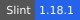
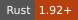
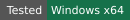
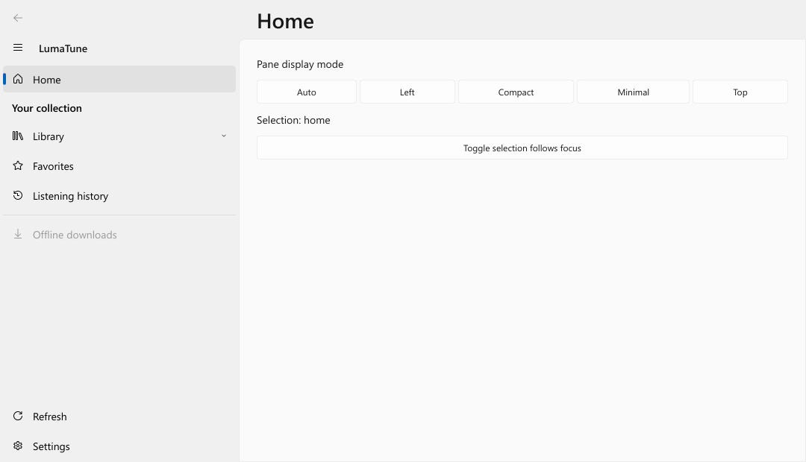
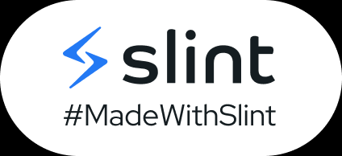

<p align="center">
  
</p>

<h1 align="center">Slint WinUI</h1>

<p align="center">
  
  
  
</p>

<p align="center">
  <strong lang="en">English</strong> · <a href="README.zh-CN.md" lang="zh-CN">简体中文</a>
</p>

Slint WinUI provides WinUI 3–inspired controls for Slint applications. It includes responsive navigation, collection views, flyouts, layout panels, and text controls, with 59 standalone examples.

<p align="center">
  
</p>

<p align="center">
  <sub><a href="examples/navigation_view.rs">NavigationView example running on Windows</a></sub>
</p>

<p align="center">
  <a href="https://slint.dev/"></a>
</p>

## Try it on Windows

Use Rust 1.92 or newer with the Windows MSVC toolchain. From this repository, run a demo with Cargo. The examples use Slint 1.18.1.

```sh
cargo run --locked --example navigation_view
cargo run --locked --example expander
cargo run --locked --example number_box
```

[Browse all examples](examples/)

## Components

> [!NOTE]
> The implementations shipped with this library currently provide full functionality only on Windows for `CalendarDatePicker`, `CalendarView`, `DatePicker`, `TimePicker`, `PasswordBox`, `RichTextBlock`, and `RichEditBox`. Cross-platform support may be added in a future release.

| Category | Included controls |
| --- | --- |
| [Basic input](ui/components/basic-input/) | Buttons, check boxes, combo boxes, radio buttons, rating controls, sliders, and toggle switches |
| [Collections](ui/components/collections/) | `FlipView`, `GridView`, `ItemContainer`, `ItemsRepeater`, `ItemsView`, `ListView`, `TreeView` |
| [Date and time](ui/components/date-time/) | `CalendarDatePicker`, `CalendarView`, `DatePicker`, `TimePicker` |
| [Dialogs and flyouts](ui/components/dialogs-flyouts/) | `ContentDialog`, `Flyout`, `TeachingTip` |
| [Layout](ui/components/layout/) | `Border`, `Canvas`, `Expander`, `Grid`, `RelativePanel`, `SplitView`, `StackPanel`, `VariableSizedWrapGrid`, `Viewbox`, `WrapPanel` |
| [Media](ui/components/media/) | `PersonPicture` |
| [Menus and toolbars](ui/components/menus-toolbars/) | `AppBarButton`, `CommandBar`, `CommandBarFlyout`, `MenuBar`, `MenuFlyout`, `SwipeControl` |
| [Navigation](ui/components/navigation/) | `BreadcrumbBar`, `NavigationView`, `Pivot`, `SelectorBar`, `TabView`, `WindowTitleBar` |
| [Scrolling and paging](ui/components/scrolling/) | `AnnotatedScrollBar`, `PagerControl`, `PipsPager`, `ScrollBar`, `ScrollView`, `SemanticZoom` |
| [Status and information](ui/components/status-info/) | `InfoBadge`, `InfoBar`, `ProgressBar`, `ProgressRing`, `ToolTip` |
| [Text](ui/components/text/) | `AutoSuggestBox`, `NumberBox`, `PasswordBox`, `RichEditBox`, `RichTextBlock`, `TextBox`, `TextCommandBarFlyout` |

The library entry point lists the public Slint imports, including the types used by Rust adapters. [Slint exports](ui/lib.slint)

## Add controls to your app

For controls implemented entirely in Slint, such as `Button` and `Expander`, import `ui/lib.slint` using a path relative to your entry file or map a library alias to it.

> [!IMPORTANT]
> Set `SLINT_ENABLE_EXPERIMENTAL_FEATURES=1` in the Slint compiler environment when importing the library. Several controls use named slots. The Rust build script below sets it for you.

### Rust quick start

This example maps the `@winui` alias and registers the Rust adapter for `NumberBox`. Create an app with `cargo new winui-demo`. Add these entries to your app's `Cargo.toml`.

```toml
[dependencies]
slint = "=1.18.1"

[build-dependencies]
slint-build = "=1.18.1"
slint-winui = { version = "0.1.2", default-features = false }
```

Create `build.rs` in the app root.

```rust
use std::{collections::HashMap, env};

fn main() {
    // SAFETY: This runs before the build script starts any threads.
    unsafe { env::set_var("SLINT_ENABLE_EXPERIMENTAL_FEATURES", "1") };

    let config = slint_build::CompilerConfiguration::new()
        .with_library_paths(HashMap::from([("winui".into(), slint_winui::library_path())]));
    slint_build::compile_with_config("ui/main.slint", config).unwrap();

    slint_winui::write_behavior_modules(env::var_os("OUT_DIR").unwrap(), &["number_box"])
        .unwrap();
}
```

Create `ui/main.slint`. Re-export the adapter's types so the app and the adapter share the same Slint-generated Rust types.

```slint
import { Button, NumberBox, NumberBoxMath, NumberBoxParseResult, NumberBoxValue } from "@winui";

export { NumberBoxMath, NumberBoxParseResult, NumberBoxValue }

export component MainWindow inherits Window {
    title: "Slint WinUI quick start";
    preferred-width: 360px;
    preferred-height: 180px;

    VerticalLayout {
        padding: 24px;
        spacing: 12px;

        amount := NumberBox {
            header: "Amount";
            value: { number: 24, has-value: true };
            spin-placement: inline;
        }

        Button {
            text: "Reset";
            clicked => { amount.set-value({ number: 24, has-value: true }); }
        }
    }
}
```

Replace `src/main.rs` with this entry point.

```rust
use slint::ComponentHandle;

slint::include_modules!();
include!(concat!(env!("OUT_DIR"), "/slint_winui_behaviors.rs"));

fn main() -> Result<(), slint::PlatformError> {
    let ui = MainWindow::new()?;
    number_box::install(ui.global::<NumberBoxMath>());
    ui.run()
}
```

Run `cargo run` from the app directory. The number starts at 24. Use the arrows to change it and **Reset** to restore it.

### Other Rust and Windows integrations

For controls implemented entirely in Slint, keep the alias setup and `slint::include_modules!()`. Omit `write_behavior_modules`, the `include!` for its generated file, and the adapter `install` call. For controls with an adapter, use the module name, type exports, and registration from the corresponding example. [Rust behavior modules](src/behavior/) · [Example launchers](examples/)

Windows integrations, including the system calendar, password reveal policy, and native rich text, also need `slint-winui` in the app's runtime `[dependencies]` with its `windows-platform` feature enabled. See the examples for any additional dependencies or window-handle setup. [CalendarView](examples/calendar_view.rs) · [PasswordBox](examples/password_box.rs) · [RichEditBox](examples/rich_edit_box.rs)

`WindowTitleBar` lays out the title, icon, and optional Back and navigation buttons. On Windows, call `platform::title_bar::attach` on the owning UI thread after a decorated window has a live HWND. Pass the row height and `interactive-width` in logical pixels. Keep the caption row transparent so Windows draws the system buttons. Apply `maximized_inset` to the layout when maximized, and call `set_left_client_width` if the visible controls change. Run the [title-bar example](examples/window_title_bar.rs) with `cargo run --example window_title_bar`.

## Work with the examples

Run the library and example tests on Windows from the repository root.

```sh
cargo test --locked --all-targets
```

Demos have built-in sample media and data. To use your own images, set `SLINT_WINUI_SAMPLE_MEDIA` to their directory or place them in `demo-assets/` using the filenames expected by each demo. For SemanticZoom, set `SLINT_WINUI_GALLERY_DATA` to a compatible `ControlInfoData.json` file. [Image example](examples/grid_view.rs) · [SemanticZoom example](examples/semantic_zoom.rs)

[MIT License](LICENSE) · [Third-party notices](THIRD_PARTY_NOTICES.md)
