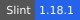
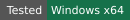
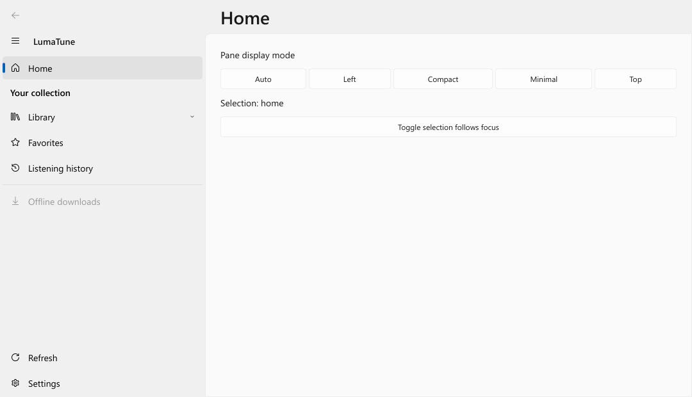

<p align="center">
  
</p>

<h1 align="center">Slint WinUI</h1>

<p align="center">
  
  
  
</p>

<p align="center">
  <a href="README.md" lang="en">English</a> · <strong lang="zh-CN">简体中文</strong>
</p>

Slint WinUI 是一套参考 WinUI 3 设计的 Slint 控件库，包含响应式导航、集合视图、浮出控件、布局面板和文本控件，并附带 59 个可独立运行的示例。

<p align="center">
  
</p>

<p align="center">
  <sub><a href="examples/navigation_view.rs">在 Windows 上运行的 NavigationView 示例</a></sub>
</p>

<p align="center">
  <a href="https://slint.dev/"></a>
</p>

## 在 Windows 上运行示例

使用 Rust 1.92 或更高版本和 Windows MSVC 工具链。在仓库根目录运行以下命令。示例使用 Slint 1.18.1。

```sh
cargo run --locked --example navigation_view
cargo run --locked --example expander
cargo run --locked --example number_box
```

[浏览全部示例](examples/)

## 组件

> [!NOTE]
> 按当前库提供的实现，`CalendarDatePicker`、`CalendarView`、`DatePicker`、`TimePicker`、`PasswordBox`、`RichTextBlock` 和 `RichEditBox` 的完整功能目前仅支持 Windows。后续版本可能会加入跨平台支持。

| 分类 | 包含的控件 |
| --- | --- |
| [基础输入](ui/components/basic-input/) | 按钮、复选框、组合框、单选按钮、评分控件、滑块和切换开关 |
| [集合](ui/components/collections/) | `FlipView`、`GridView`、`ItemContainer`、`ItemsRepeater`、`ItemsView`、`ListView`、`TreeView` |
| [日期和时间](ui/components/date-time/) | `CalendarDatePicker`、`CalendarView`、`DatePicker`、`TimePicker` |
| [对话框和浮出控件](ui/components/dialogs-flyouts/) | `ContentDialog`、`Flyout`、`TeachingTip` |
| [布局](ui/components/layout/) | `Border`、`Canvas`、`Expander`、`Grid`、`RelativePanel`、`SplitView`、`StackPanel`、`VariableSizedWrapGrid`、`Viewbox`、`WrapPanel` |
| [媒体](ui/components/media/) | `PersonPicture` |
| [菜单和工具栏](ui/components/menus-toolbars/) | `AppBarButton`、`CommandBar`、`CommandBarFlyout`、`MenuBar`、`MenuFlyout`、`SwipeControl` |
| [导航](ui/components/navigation/) | `BreadcrumbBar`、`NavigationView`、`Pivot`、`SelectorBar`、`TabView`、`WindowTitleBar` |
| [滚动和分页](ui/components/scrolling/) | `AnnotatedScrollBar`、`PagerControl`、`PipsPager`、`ScrollBar`、`ScrollView`、`SemanticZoom` |
| [状态和信息](ui/components/status-info/) | `InfoBadge`、`InfoBar`、`ProgressBar`、`ProgressRing`、`ToolTip` |
| [文本](ui/components/text/) | `AutoSuggestBox`、`NumberBox`、`PasswordBox`、`RichEditBox`、`RichTextBlock`、`TextBox`、`TextCommandBarFlyout` |

库入口列出了可导入的 Slint 组件，以及 Rust 适配器需要的类型。[Slint 导出](ui/lib.slint)

## 在应用中接入组件

对于 `Button`、`Expander` 等纯 Slint 控件，可以使用相对于应用入口文件的路径导入 `ui/lib.slint`，也可以为它配置库别名。

> [!IMPORTANT]
> 部分控件使用命名插槽。导入组件库时，需要在 Slint 编译器环境中设置 `SLINT_ENABLE_EXPERIMENTAL_FEATURES=1`。下面的 Rust 构建脚本会完成这一步。

### Rust 快速入门

这个例子配置 `@winui` 别名，并注册 `NumberBox` 的 Rust 适配器。运行 `cargo new winui-demo` 创建应用。将以下依赖添加到应用的 `Cargo.toml`。

```toml
[dependencies]
slint = "=1.18.1"

[build-dependencies]
slint-build = "=1.18.1"
slint-winui = { version = "0.1.2", default-features = false }
```

在应用根目录创建 `build.rs`。

```rust
use std::{collections::HashMap, env};

fn main() {
    // SAFETY: This runs before the build script starts any threads.
    unsafe { env::set_var("SLINT_ENABLE_EXPERIMENTAL_FEATURES", "1") };

    let config = slint_build::CompilerConfiguration::new()
        .with_library_paths(HashMap::from([("winui".into(), slint_winui::library_path())]));
    slint_build::compile_with_config("ui/main.slint", config).unwrap();

    slint_winui::write_behavior_modules(env::var_os("OUT_DIR").unwrap(), &["number_box"])
        .unwrap();
}
```

创建 `ui/main.slint`。在入口文件中重新导出适配器用到的类型，让应用和适配器使用同一组由 Slint 生成的 Rust 类型。

```slint
import { Button, NumberBox, NumberBoxMath, NumberBoxParseResult, NumberBoxValue } from "@winui";

export { NumberBoxMath, NumberBoxParseResult, NumberBoxValue }

export component MainWindow inherits Window {
    title: "Slint WinUI quick start";
    preferred-width: 360px;
    preferred-height: 180px;

    VerticalLayout {
        padding: 24px;
        spacing: 12px;

        amount := NumberBox {
            header: "Amount";
            value: { number: 24, has-value: true };
            spin-placement: inline;
        }

        Button {
            text: "Reset";
            clicked => { amount.set-value({ number: 24, has-value: true }); }
        }
    }
}
```

替换应用的 `src/main.rs`。

```rust
use slint::ComponentHandle;

slint::include_modules!();
include!(concat!(env!("OUT_DIR"), "/slint_winui_behaviors.rs"));

fn main() -> Result<(), slint::PlatformError> {
    let ui = MainWindow::new()?;
    number_box::install(ui.global::<NumberBoxMath>());
    ui.run()
}
```

在应用目录运行 `cargo run`。数值初始为 24，点击箭头可增减，点击 **Reset** 可恢复初始值。

### 其他 Rust 和 Windows 集成

接入纯 Slint 控件时，保留库别名配置和 `slint::include_modules!()`，省略 `write_behavior_modules`、引入生成文件的 `include!` 和适配器的 `install` 调用。接入其他带适配器的控件时，可以从对应示例查看模块名、需要导出的类型和注册方式。[Rust 行为模块](src/behavior/) · [示例入口](examples/)

系统日历、密码显示策略和原生富文本等功能依赖 Windows。使用这些功能时，也要在应用的运行时 `[dependencies]` 中加入 `slint-winui` 并启用 `windows-platform`。具体依赖和窗口句柄的接入方式可参照示例。[CalendarView](examples/calendar_view.rs) · [PasswordBox](examples/password_box.rs) · [RichEditBox](examples/rich_edit_box.rs)

`WindowTitleBar` 排列标题、应用图标以及可选的返回和导航按钮。使用 Windows 原生窗口按钮时，先创建带系统边框的窗口，再在窗口所属的 UI 线程用 HWND 调用 `platform::title_bar::attach`。标题栏高度和 `interactive-width` 均以逻辑像素传入。标题区保持透明，以显示系统按钮。最大化时用 `maximized_inset` 补偿布局，按钮显示状态变化后用 `set_left_client_width` 更新点击区域。运行 `cargo run --example window_title_bar` 可体验示例。[标题栏示例](examples/window_title_bar.rs)

## 测试和示例资源

在 Windows 上从仓库根目录运行库和示例的测试。

```sh
cargo test --locked --all-targets
```

示例自带媒体和数据。要换用自己的图片，可将 `SLINT_WINUI_SAMPLE_MEDIA` 指向图片目录，或按示例所需的文件名将图片放进 `demo-assets/`。SemanticZoom 可通过 `SLINT_WINUI_GALLERY_DATA` 指定兼容的 `ControlInfoData.json` 文件。[图片示例](examples/grid_view.rs) · [SemanticZoom 示例](examples/semantic_zoom.rs)

[MIT 许可证](LICENSE) · [第三方声明](THIRD_PARTY_NOTICES.md)
